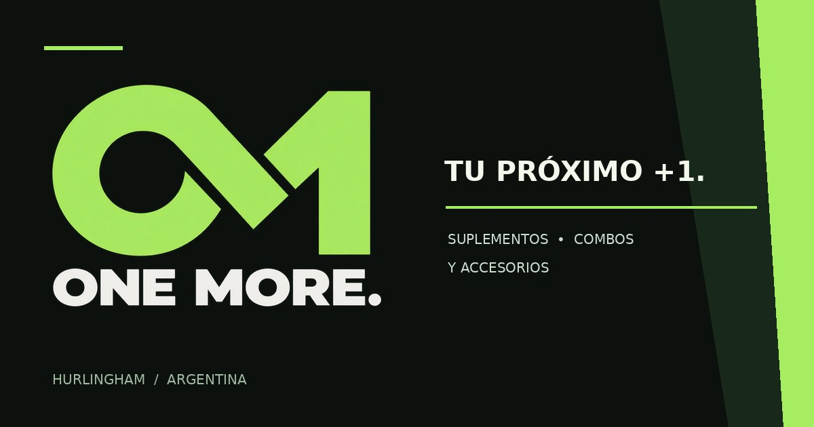

# ONE MORE — ecommerce de suplementos



Aplicación web responsive para una tienda de suplementos deportivos. Reúne el catálogo público, armado de pedidos, contacto por WhatsApp y un back office con inventario, compras, ventas, caja, variantes y seguimiento comercial.

**Sitio publicado:** [one-more.com.ar](https://one-more.com.ar/)

## Funcionalidades principales

- Catálogo responsive con categorías, variantes, precios e imágenes administrables.
- Carrito y preparación del pedido para continuar la conversación por WhatsApp.
- Gestión de stock propio, compras, ventas, devoluciones y conciliaciones.
- Caja por medios de pago, gastos, aportes, retiros y movimientos auditables.
- Panel administrativo con roles, sesiones y control de concurrencia.
- Gestión de productos, sabores, presentaciones y archivos en Cloudflare R2.
- Módulos de partners, consultas, seguimiento y métricas.
- Pruebas unitarias, de integración y flujos de navegador.

## Tecnologías

- HTML, CSS y JavaScript modular.
- Cloudflare Pages Functions para la API.
- Cloudflare D1 como base de datos SQLite.
- Cloudflare R2 para imágenes de productos.
- Node.js Test Runner y Playwright.
- Wrangler para desarrollo y despliegue.

## Estructura

```text
sitio/
├── assets/              # estilos y módulos del storefront
├── functions/api/       # API pública y administrativa
├── images/              # recursos visuales del catálogo
├── productos/           # páginas de detalle
└── wrangler.example.json
tests/                   # pruebas automáticas y fixtures
tools/                   # utilidades de desarrollo local
```

## Desarrollo local

Requiere Node.js 24.10 o posterior.

```bash
npm install
npm run demo
```

Para ejecutar las pruebas:

```bash
npm test
```

## Configuración de Cloudflare

1. Copiar `sitio/wrangler.example.json` como `sitio/wrangler.json`.
2. Reemplazar los valores de ejemplo por los identificadores del proyecto, la base D1 y el bucket R2 propios.
3. Configurar las claves administrativas como secretos de Cloudflare; nunca incorporarlas al repositorio.

## Sobre esta versión pública

Esta es una copia de portfolio basada en la versión V181. Se excluyeron respaldos, bases locales, auditorías, comprobantes, datos de producción y configuración privada. Los identificadores de infraestructura fueron reemplazados por valores de ejemplo.

Desarrollado por **Thomas Vai**.
